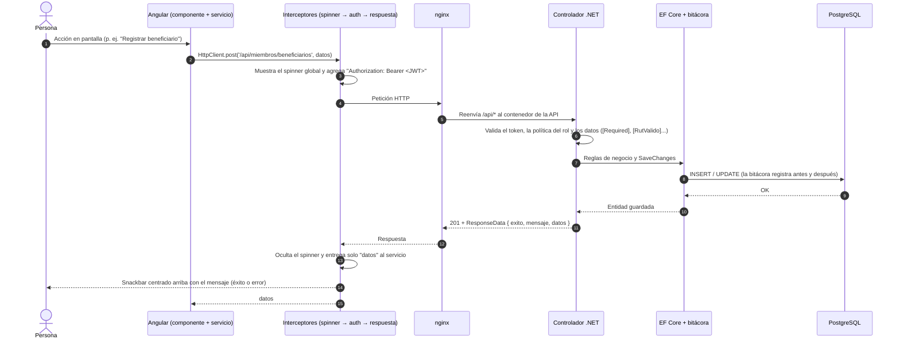

# API de Talí

API REST de .NET 10 que consume el frontend Angular. Todas las rutas parten con `/api` y responden JSON con el formato único `ResponseData`.

## Recorrido de una petición



Si algo falla, la API responde con el código HTTP que corresponde y un `ResponseData` con `exito: false`. El interceptor de respuesta muestra `mensaje` (y `errores`, si vienen) en el snackbar. Así ningún componente necesita manejar errores por su cuenta.

## Convención de rutas

```
/api/{modulo}/{recurso}[/{id}][/{subrecurso | accion}]
```

| Regla | Ejemplo |
|---|---|
| Módulo y recurso en español, en plural y en kebab-case | `/api/miembros/beneficiarios`, `/api/miembros/beneficiarios/7/ficha-medica` |
| El id va en la ruta, nunca en el cuerpo | `PUT /api/miembros/apoderados/3` |
| Lo que depende de otro recurso va anidado bajo ese recurso | `/api/miembros/beneficiarios/7/contactos` |
| Acción que no es un CRUD: `POST` con un verbo en infinitivo | `POST /api/miembros/beneficiarios/7/retirar` |
| Filtros, búsqueda y paginación como parámetros de consulta | `?buscar=pérez&unidadId=2&estado=activo&pagina=1&tamano=20` |

Módulos: `auth`, `base`, `miembros`, `inventario`, `finanzas` y `portal`. La única excepción es `/api/health`, que usa la ruta de salud habitual y la consultan Docker y los monitores.

### Verbos

| Verbo | Uso | Respuesta habitual |
|---|---|---|
| `GET` | Consultar (nunca modifica) | 200 |
| `POST` | Crear, o ejecutar una acción | 201 al crear (con encabezado `Location`), 200 en una acción |
| `PUT` | Reemplazar los datos editables de un recurso | 200 |
| `DELETE` | Eliminar (solo lo que no tiene historial; lo demás se **desactiva** o se **retira**) | 200 |

## Formato de respuesta: `ResponseData<T>`

```json
{ "exito": true, "mensaje": "Beneficiario registrado.", "datos": { "id": 21, "rut": "12.345.678-5" }, "errores": null }
```

| Código | Cuándo | Ejemplo de `mensaje` |
|---|---|---|
| 200 / 201 | Todo bien | `"Apoderado vinculado."` (o `null` en consultas) |
| 400 | Datos inválidos; `errores` trae el detalle por campo | `"Revisa los datos ingresados."`, `errores: ["El RUT no es válido."]` |
| 401 | Sin sesión o con el token vencido (el frontend vuelve al inicio de sesión) | `"Debes iniciar sesión para continuar."` |
| 403 | El rol no tiene permiso, o falta cambiar la contraseña temporal | `"No tienes permiso para realizar esta acción."` |
| 404 | El recurso no existe | `"No se encontró el beneficiario."` |
| 409 | Choca con una regla de negocio | `"Ya existe un beneficiario con ese RUT."`, `"La unidad tiene beneficiarios activos."` |
| 500 | Error inesperado (el detalle solo queda en el log del servidor) | `"Ocurrió un error en el servidor. Intenta nuevamente en unos minutos."` |

### Listados paginados

Los listados extensos reciben `pagina` (desde 1), `tamano` (entre 1 y 100; por defecto 20) y `buscar`, y devuelven:

```json
{ "elementos": [ ... ], "total": 57, "paginaActual": 1, "tamano": 20, "totalPaginas": 3 }
```

El RUT se acepta con o sin puntos y guion, se guarda normalizado (`12345678-5`) y se entrega formateado (`12.345.678-5`). Las fechas sin hora van como `aaaa-mm-dd` y las fechas con hora en UTC (ISO 8601).

## Autenticación y permisos

1. `POST /api/auth/login` entrega un **JWT** válido por 8 horas con el id, el nombre y los roles de la persona.
2. El frontend lo guarda y lo envía en cada petición: `Authorization: Bearer <token>`.
3. Cada controlador exige una **política** según el módulo, y algunas acciones exigen una política más estricta.
4. Una cuenta con contraseña temporal solo puede usar `auth/me` y `auth/cambiar-password` hasta que la cambie (403 en todo lo demás).

| Política | Roles | Se usa en |
|---|---|---|
| `Miembros` | administrador, dirigente | Todo `/api/miembros` (por ahora el dirigente ve todas las unidades) |
| `Administracion` | administrador | `/api/base/*`; crear, editar, desactivar o eliminar unidades; cuenta del Portal |
| `Inventario` / `InventarioEscritura` | administrador, tesorería, dirigente, revisor / sin el revisor | `/api/inventario` |
| `Finanzas` / `FinanzasEscritura` | administrador, tesorería, revisor / administrador y tesorería | `/api/finanzas` |
| `Portal` | administrador, tesorería, apoderado | `/api/portal` |

El frontend oculta los menús según el rol (`core/auth/permisos.ts`), pero la seguridad real está en la API.

## Endpoints

### Autenticación y salud

| Método | Ruta | Roles | Descripción |
|---|---|---|---|
| POST | `/api/auth/login` | Público | Inicia sesión y entrega el JWT |
| GET | `/api/auth/me` | Con sesión | Datos de la persona conectada |
| POST | `/api/auth/cambiar-password` | Con sesión | Cambia la contraseña (también la temporal) y entrega un token nuevo |
| GET | `/api/health` | Público | Estado de la API y de la conexión a la base de datos |

### Base: usuarios y roles

| Método | Ruta | Roles | Descripción |
|---|---|---|---|
| GET | `/api/base/usuarios` | administrador | Listado paginado (`buscar`, `rol`, `activo`) |
| GET | `/api/base/usuarios/{id}` | administrador | Detalle |
| POST | `/api/base/usuarios` | administrador | Crea la cuenta con contraseña temporal (se muestra una sola vez) |
| PUT | `/api/base/usuarios/{id}` | administrador | Edita el nombre y el correo |
| PUT | `/api/base/usuarios/{id}/roles` | administrador | Asigna roles (no puedes quitarte tu propio rol de administrador) |
| POST | `/api/base/usuarios/{id}/activar` · `/desactivar` | administrador | Habilita o bloquea el acceso (no puedes desactivarte) |
| POST | `/api/base/usuarios/{id}/restablecer-password` | administrador | Genera una nueva contraseña temporal |
| GET | `/api/base/roles` | administrador | Roles disponibles |

### Miembros: unidades y patrullas

| Método | Ruta | Roles | Descripción |
|---|---|---|---|
| GET | `/api/miembros/unidades` | admin, dirigente | Unidades con sus patrullas y beneficiarios activos (`incluirInactivas`) |
| GET | `/api/miembros/unidades/{id}` | admin, dirigente | Detalle |
| POST / PUT | `/api/miembros/unidades[/{id}]` | administrador | Crea o edita (nombre y rama) |
| POST | `/api/miembros/unidades/{id}/desactivar` · `/activar` | administrador | 409 si se intenta desactivar con beneficiarios activos |
| DELETE | `/api/miembros/unidades/{id}` | administrador | Solo si no tiene beneficiarios, patrullas, historial ni cargos |
| POST | `/api/miembros/unidades/{unidadId}/patrullas` | admin, dirigente | Crea una patrulla |
| PUT | `/api/miembros/patrullas/{id}` | admin, dirigente | Renombra |
| POST | `/api/miembros/patrullas/{id}/desactivar` · `/activar` | admin, dirigente | Cambia el estado |
| DELETE | `/api/miembros/patrullas/{id}` | admin, dirigente | Solo si no tiene beneficiarios |

### Miembros: beneficiarios

| Método | Ruta | Roles | Descripción |
|---|---|---|---|
| GET | `/api/miembros/beneficiarios` | admin, dirigente | Listado paginado (`buscar` por nombre o RUT, `unidadId`, `patrullaId`, `estado`) |
| GET | `/api/miembros/beneficiarios/{id}` | admin, dirigente | Ficha con edad, unidad y rama |
| POST | `/api/miembros/beneficiarios` | admin, dirigente | Registra y anota el **ingreso** en el historial |
| PUT | `/api/miembros/beneficiarios/{id}` | admin, dirigente | Edita; el cambio de unidad o de patrulla queda en el historial |
| POST | `/api/miembros/beneficiarios/{id}/retirar` | admin, dirigente | Retira (fecha y motivo); los datos se conservan |
| POST | `/api/miembros/beneficiarios/{id}/reingresar` | admin, dirigente | Reingresa, en la misma unidad u otra |
| GET | `/api/miembros/beneficiarios/{id}/historial` | admin, dirigente | Movimientos, del más reciente al más antiguo, con quién los registró |
| GET / POST | `/api/miembros/beneficiarios/{id}/contactos` | admin, dirigente | Contactos de emergencia (máximo 5) |
| PUT / DELETE | `/api/miembros/beneficiarios/{id}/contactos/{contactoId}` | admin, dirigente | Edita o elimina un contacto |
| GET / PUT | `/api/miembros/beneficiarios/{id}/ficha-medica` | admin, dirigente | Ficha médica (se guarda **cifrada**; registra quién la modificó) |
| GET / POST | `/api/miembros/beneficiarios/{id}/apoderados` | admin, dirigente | Vínculos con apoderados; el primero queda como principal |
| PUT / DELETE | `/api/miembros/beneficiarios/{id}/apoderados/{apoderadoId}` | admin, dirigente | Cambia parentesco o principal, o desvincula |

### Miembros: apoderados

| Método | Ruta | Roles | Descripción |
|---|---|---|---|
| GET | `/api/miembros/apoderados` | admin, dirigente | Listado paginado (`buscar` por nombre, correo o RUT) |
| GET | `/api/miembros/apoderados/{id}` | admin, dirigente | Detalle con sus beneficiarios |
| POST / PUT | `/api/miembros/apoderados[/{id}]` | admin, dirigente | Registra o edita |
| DELETE | `/api/miembros/apoderados/{id}` | admin, dirigente | Solo sin beneficiarios vinculados |
| POST | `/api/miembros/apoderados/{id}/cuenta` | administrador | Crea su cuenta del Portal con contraseña temporal, o vincula la existente |

### Miembros: voluntarios y cargos

| Método | Ruta | Roles | Descripción |
|---|---|---|---|
| GET | `/api/miembros/voluntarios` | admin, dirigente | Listado paginado con cargos vigentes (`buscar`, `unidadId`, `conCargo`) |
| GET | `/api/miembros/voluntarios/{id}` | admin, dirigente | Detalle con todos sus cargos (vigentes e historial) |
| POST / PUT | `/api/miembros/voluntarios[/{id}]` | admin, dirigente | Registra o edita |
| DELETE | `/api/miembros/voluntarios/{id}` | admin, dirigente | Solo si nunca tuvo cargos |
| POST | `/api/miembros/voluntarios/{id}/cargos` | admin, dirigente | Asigna un cargo (de grupo o de una unidad) |
| PUT / DELETE | `/api/miembros/voluntarios/{id}/cargos/{cargoId}` | admin, dirigente | Corrige o elimina un registro erróneo |
| POST | `/api/miembros/voluntarios/{id}/cargos/{cargoId}/terminar` | admin, dirigente | Termina el cargo (pasa al historial) |

### Módulos en construcción

`GET /api/inventario`, `/api/finanzas` y `/api/portal` solo informan que el módulo está en construcción, pero ya están protegidos por su política.

## Probar la API

Con el entorno levantado (`docker compose up -d`), la API responde en `http://localhost:8081`. En desarrollo, la especificación OpenAPI está en `/openapi/v1.json`:

```bash
curl -s -X POST http://localhost:8081/api/auth/login -H "Content-Type: application/json" \
  -d '{"email":"admin@demo.cl","password":"TaliDemo2026"}'
```
