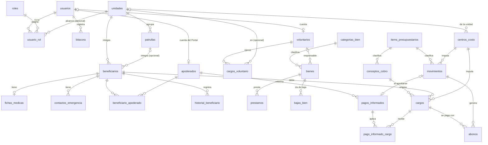
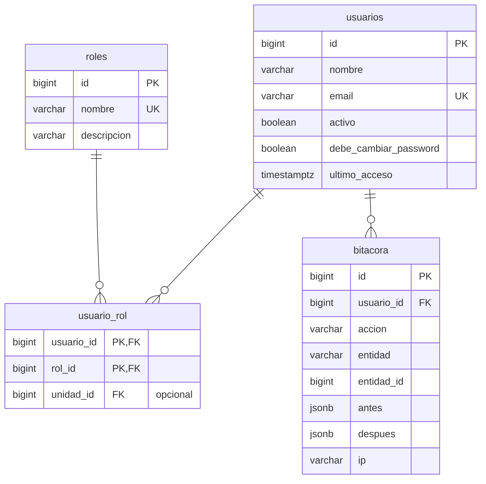
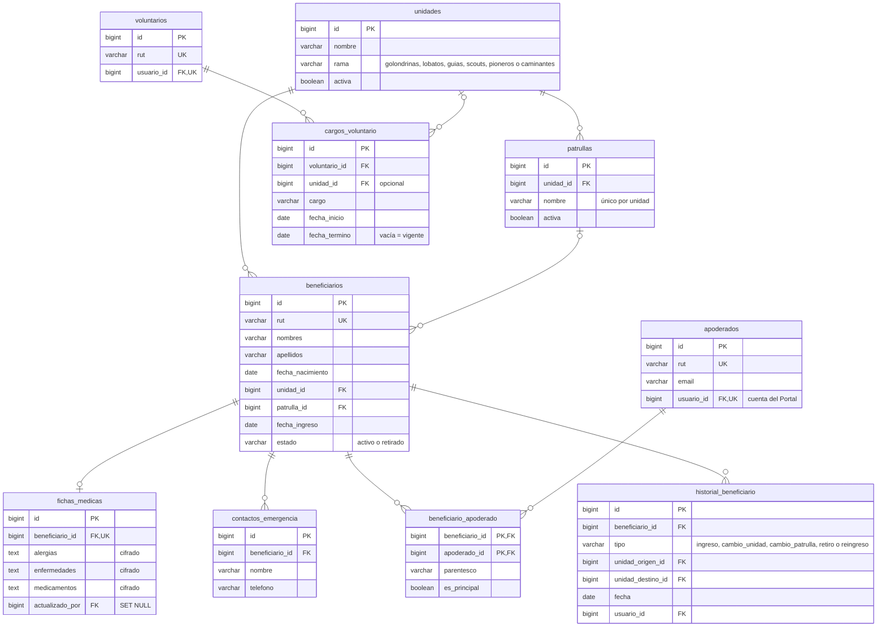

# Modelo de datos

Base de datos PostgreSQL 18 con **28 tablas del dominio**, agrupadas en 5 módulos, más las tablas de soporte de ASP.NET Identity y de Data Protection. Las tablas las crean las **migraciones de Entity Framework Core** (`backend/src/EcosistemaScout.Api/Datos/Migraciones`) al arrancar la API. `database/schema.sql` es el modelo de referencia original.

Convenciones:

- nombres en español y en `snake_case`;
- `id bigint` autoincremental como clave primaria;
- `created_at` / `updated_at` en UTC;
- montos en pesos chilenos como enteros;
- valores fijos validados con `CHECK` (rama, estado, tipo...).

## Cómo ver el diagrama

- **GitHub o VS Code** muestran los diagramas Mermaid de este archivo. En VS Code, usa la vista previa de Markdown (`Ctrl+Shift+V`) con la extensión *Markdown Preview Mermaid Support*.
- **Diagrama completo con todas las columnas:** con Docker levantado, conéctate desde DBeaver o pgAdmin a `localhost:5433`, base de datos `ecosistema_scout` (los valores de desarrollo están en `docker-compose.yml`). Luego abre *ER Diagram* sobre el esquema `public`.

## Vista general

## Módulo Base

| Tabla | Para qué sirve |
|---|---|
| `configuracion_grupo` | Datos del grupo: nombre, número, distrito y zona, cuenta bancaria para las transferencias y logo |
| `usuarios` | Cuentas de acceso (ASP.NET Identity). `debe_cambiar_password` obliga a cambiar la contraseña temporal |
| `roles` | administrador, tesorería, dirigente, apoderado y revisor |
| `usuario_rol` | Roles de cada usuario (acumulables), con unidad opcional para limitar el alcance a futuro |
| `bitacora` | Auditoría automática: quién, cuándo, desde qué IP y el antes y después de cada cambio. Los datos de salud quedan como `"(dato protegido)"` |

## Módulo Gestión de Miembros

| Tabla | Para qué sirve |
|---|---|
| `unidades` | Unidades del grupo, una rama por unidad. No se eliminan si tienen beneficiarios: se desactivan |
| `patrullas` | Subdivisiones de una unidad (patrulla, seisena, equipo). El nombre no se repite dentro de la unidad |
| `beneficiarios` | Niños, niñas y jóvenes. RUT único, guardado sin puntos (`12345678-5`). Nunca se borran: se retiran |
| `fichas_medicas` | Previsión, grupo sanguíneo, alergias, enfermedades, medicamentos, restricciones alimentarias y necesidades emocionales, **cifradas** con ASP.NET Data Protection |
| `contactos_emergencia` | Hasta 5 personas a quienes llamar por cada beneficiario |
| `apoderados` | Adultos responsables. `usuario_id` enlaza su cuenta del Portal de pagos |
| `beneficiario_apoderado` | Vínculo de muchos a muchos con parentesco y un único apoderado principal por beneficiario |
| `historial_beneficiario` | Registro automático de ingresos, cambios de unidad o patrulla, retiros y reingresos |
| `voluntarios` | Dirigentes y adultos colaboradores; pueden tener cuenta de usuario |
| `cargos_voluntario` | Cargos de grupo o de unidad, con fechas. Los terminados quedan como historial |

## Módulo Inventario

| Tabla | Para qué sirve |
|---|---|
| `categorias_bien` | Clasificación de los bienes (carpas, cocina, herramientas...) |
| `bienes` | Ítems con los campos del formulario DAF-FOR-04: código, cantidad, origen, estado, ubicación, responsable y foto |
| `prestamos` | Salidas y devoluciones, con destinatario, actividad y estado al volver |
| `bajas_bien` | Bajas con motivo (pérdida, deterioro, donación...) |

## Módulo Financiamiento

| Tabla | Para qué sirve |
|---|---|
| `items_presupuestarios` | Plan de cuentas de ingresos y egresos |
| `centros_costo` | Grupo o unidad a la que se imputa cada movimiento |
| `movimientos` | Ingresos y egresos con comprobante correlativo por año. Se anulan, nunca se borran |
| `cierres_mensuales` | Saldos de cada mes cerrado (libro de control DAF-FOR-02) |
| `conceptos_cobro` | Cuotas y cobros (cuota anual, campamento...) con monto sugerido |
| `cargos` | Deuda de cada beneficiario por concepto, con vencimiento y estado |
| `abonos` | Pagos aplicados a un cargo, ligados al movimiento de ingreso |

## Módulo Portal de pagos

| Tabla | Para qué sirve |
|---|---|
| `pagos_informados` | Transferencias que informa el apoderado, con comprobante. Tesorería las aprueba o las rechaza |
| `pago_informado_cargo` | Cómo se reparte una transferencia entre los cargos que paga |

## Tablas de soporte

| Tabla | Para qué sirve |
|---|---|
| `usuario_claims`, `usuario_logins`, `usuario_tokens`, `rol_claims` | Tablas internas de ASP.NET Identity |
| `data_protection_keys` | Llaves de cifrado de la ficha médica. Se guardan en la base de datos para que sobrevivan a los reinicios. **Excluida de la bitácora** |
| `__EFMigrationsHistory` | Migraciones aplicadas |

## Cambios respecto de `schema.sql`

| Cambio | Motivo |
|---|---|
| `usuarios.debe_cambiar_password` | Forzar el cambio de la contraseña temporal en el primer ingreso |
| `fichas_medicas.actualizado_por` pasa de `ON DELETE CASCADE` a `SET NULL` | Eliminar la cuenta de quien editó una ficha no debe borrar la ficha del beneficiario |
| `fichas_medicas.prevision` y `grupo_sanguineo` pasan de `varchar(40)`/`varchar(5)` a `text` | Se guardan cifradas y el texto cifrado es más largo; la API valida el largo antes de cifrar |
| Nueva tabla `data_protection_keys` | Persistir las llaves de cifrado |
